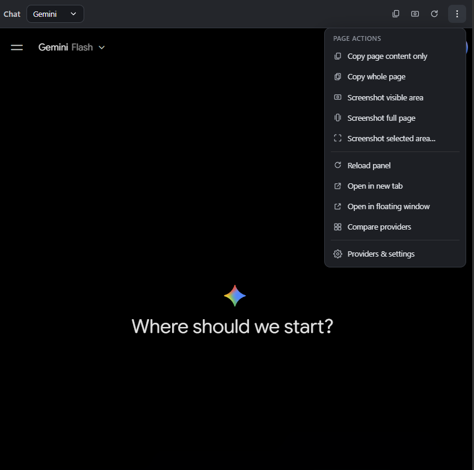
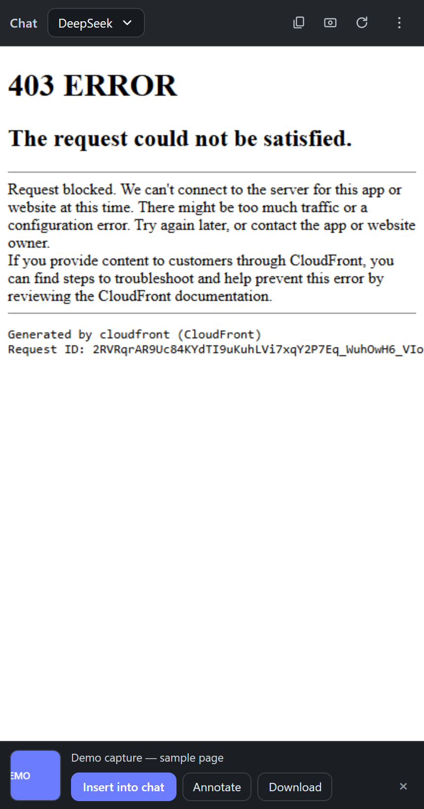
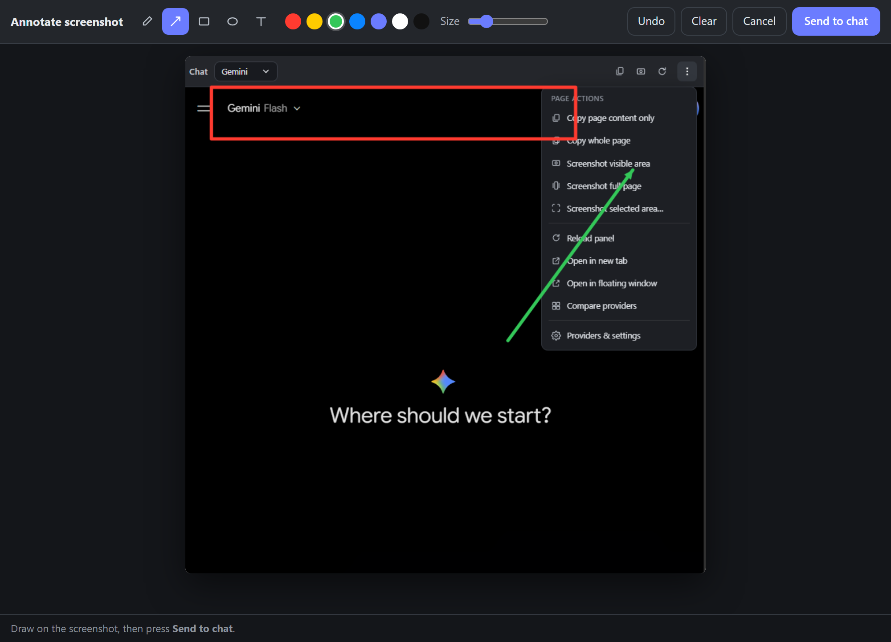

# AI Chat Sidebar

A Chrome/Edge **side panel** that hosts your AI chat sites — ChatGPT, Gemini, DeepSeek, Qwen,
Perplexity, or any URL you add — in one docked panel, with one-click "send this page to the chat"
helpers.

It is an independent Manifest V3 reimplementation of the *Chat* panel that ships inside
[BrowserOS](https://github.com/browseros-ai/BrowserOS) (a Chromium fork). **No BrowserOS code is
included here** — that panel is C++ compiled into their browser, so this project rebuilds the same
workflow with browser-extension APIs.



## Features

| Feature | Notes |
| --- | --- |
| Provider switcher | Defaults: ChatGPT, Gemini, DeepSeek, Qwen, Perplexity. Add/edit/remove any URL in settings. |
| Embedded site in the side panel | Sites that forbid framing have `X-Frame-Options` / `Content-Security-Policy` stripped for sub-frames via `declarativeNetRequest`. |
| **Copy page → chat** | Click = article content only (drops header/nav/sidebar/footer). `Alt+click` = whole page. |
| **Screenshot → chat** | Click = visible area. `Alt+click` = full page. Menu also offers *full page* and *selected areas*. |
| **Result tray** | Every capture opens a tray with a thumbnail and explicit actions: **Insert into chat**, **Annotate**, **Download**, discard. You always see that the capture worked. |
| **Annotate** | Draw pen strokes, arrows, rectangles, ellipses and text on the capture; **Send to chat** flattens it back into the panel. |
| Full-page capture | Scroll-and-stitch, so fixed/sticky headers don't repeat (Chromium's `captureBeyondViewport` duplicates them). The page visibly scrolls while capturing. |
| Multi-area capture | Drag as many rectangles as you want, `Enter` to finish, `Esc` to cancel; areas are stitched into one image. |
| Reset LLM chat | Reloads the provider panel to a clean conversation. |
| Compare providers | "Clash of GPTs" grid: 2–4 providers side by side in one tab. |
| Settings | Provider list, active-provider radio, defaults reset. |

Copy and screenshot always target **the page you are browsing** (the active tab), never the panel
itself.

### Result tray



### Annotation editor



## Install

### Option A — packaged build (recommended)

1. Download **`ai-chat-sidebar-1.6.0.zip`** from
   [Releases](https://github.com/diehendrick/ai-chat-sidebar/releases/latest) and extract it.
2. Open `edge://extensions` (Edge) or `chrome://extensions` (Chrome).
3. Enable **Developer mode**.
4. Click **Load unpacked** and select the extracted folder (it contains `manifest.json`).
5. Click the toolbar icon to open the side panel.

### Option B — from source

1. Clone this repo.
2. `edge://extensions` → **Developer mode** → **Load unpacked** → select the **`extension/`** folder.
3. Click the toolbar icon to open the side panel.

Requirements: Chrome/Edge 116+ (Manifest V3 `sidePanel`).

## Usage

- Toolbar on the right: **Copy**, **Screenshot**, **Reset** — the three you use most — plus a `⋮`
  menu with the rest (reload, open in tab, floating window, compare, settings).
- `Alt+click` on Copy/Screenshot switches the scope (whole page / full page).
- In the `⋮` menu, *Page actions* holds every variant: copy content only, copy whole page,
  screenshot visible area, screenshot full page, screenshot selected areas.
- After a capture the **result tray** appears at the bottom: *Insert into chat*, *Annotate*,
  *Download*, or dismiss. *Annotate* opens an editor window; **Send to chat** there returns the
  flattened image to the panel and copies it.

### Why a Ctrl+V is still needed

The panel embeds the provider site in a cross-origin `<iframe>`, so the extension is not allowed to
write into the provider's input box. Screenshots are therefore copied to the clipboard and the chat
frame is focused — one `Ctrl+V` drops the image into the conversation. Copies of page **text** go
straight to the clipboard as well.

## Permissions

| Permission | Why |
| --- | --- |
| `sidePanel` | Docks the UI as a browser side panel. |
| `tabs` | Picks the active tab as the copy/screenshot target, plus open-in-tab and floating window. |
| `scripting` | Reads page text and injects the area-selection overlay. |
| `clipboardWrite` | Puts page text / screenshots on the clipboard. |
| `unlimitedStorage` | Holds the pending screenshot while the annotation editor window is open. |
| `declarativeNetRequest` | Removes `X-Frame-Options` and CSP `frame-ancestors` for sub-frames of configured providers. |
| `<all_urls>` | Works on whatever page or provider you are using. No data leaves your machine. |

## Development

No build step: plain HTML/CSS/JS. Edit files in `extension/`, then press **Reload** on the
extensions page.

Automated checks live in `tools/` and drive a real Chromium over CDP (headless):

```bash
node tools/test-scopes.mjs        # copy scopes, screenshot scopes, toolbar/menu structure
node tools/test-ui.mjs            # settings drawer, default provider, compare view
node tools/test-annotate.mjs      # result tray + annotation editor round-trip
node tools/validate-extension.mjs extension   # manifest ↔ files, PNG decode
node tools/visual-fullpage.mjs    # writes docs/fullpage-sample.png for visual inspection
node tools/screenshot.mjs         # writes docs/preview.png
node tools/screenshot-v16.mjs     # writes docs/result-tray.png and docs/annotate-editor.png
```

`test-scopes.mjs` and `visual-fullpage.mjs` start a local HTTP server with a controlled test page.
Set `BROWSER_PATH` to your Edge/Chrome binary if it is not in the default Windows location.

## Troubleshooting

**“Failed to load extension — Could not load icon `icon/16.png` specified in `icons`.”**

That path is **not** from this extension. This project references `icons/…` (**plural**). The
singular `icon/…` belongs to the BrowserOS “Assistant” bundle that ships inside the BrowserOS
Chromium fork — a research artefact, not this project.

- Correct folder to load: **`extension/`** (or the release ZIP) — its manifest points at
  `icons/16.png`, `icons/48.png`, `icons/128.png`.
- Verify a folder before loading:

  ```bash
  node tools/validate-extension.mjs extension
  ```

  It prints `OK` per icon and fails if the manifest references a missing or malformed PNG.

**Other load errors on macOS/Linux**

- Extract the release ZIP with the system archive tool, or simply `git clone` the repo and load
  `extension/` directly — that avoids any archive quirks.
- Load the folder that *contains* `manifest.json`, not its parent.

## Project layout

```
extension/   load-unpacked extension (manifest, panel UI, compare view, icons)
tools/       CDP test harnesses, asset generators, extension validator
docs/        screenshots used by this README
```

## Limitations

- Sites with aggressive bot protection may refuse to render inside an iframe or may show a challenge.
- Clipboard image writes need a focused document; if the browser refuses, the PNG is downloaded instead.
- Full-page capture steps one viewport at a time (≈0.5 s each, browser rate limit) and hides
  fixed/sticky elements while capturing; pages longer than ~40 viewports are truncated.
- Chrome's branded builds ignore `--load-extension`; use Developer mode → *Load unpacked*.

## License

MIT — see [LICENSE](LICENSE).
